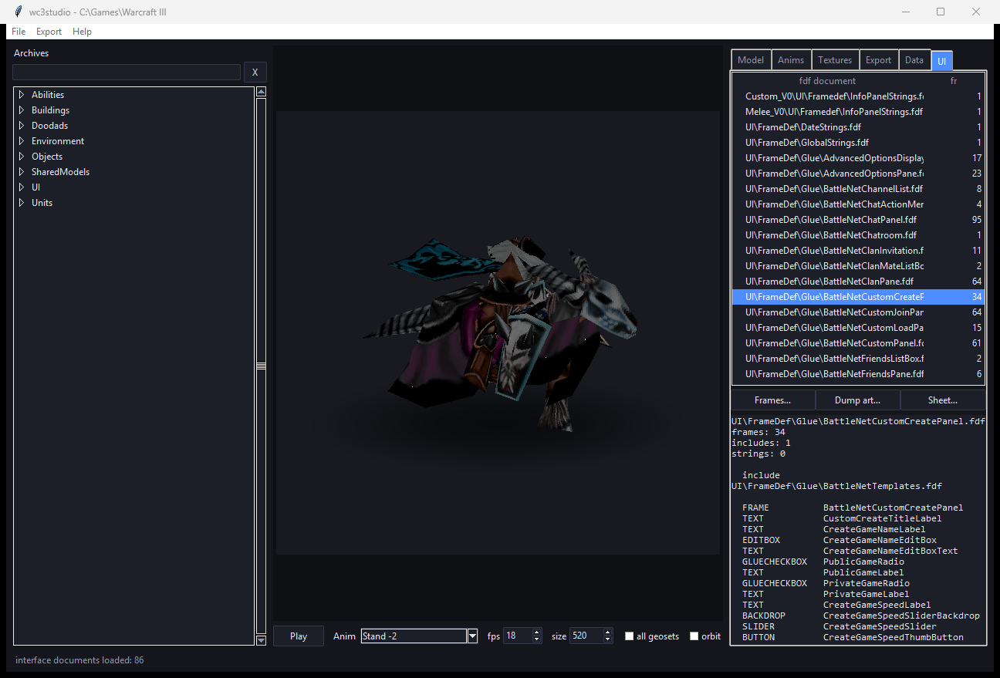
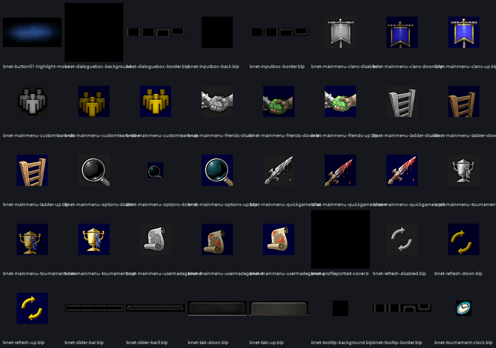
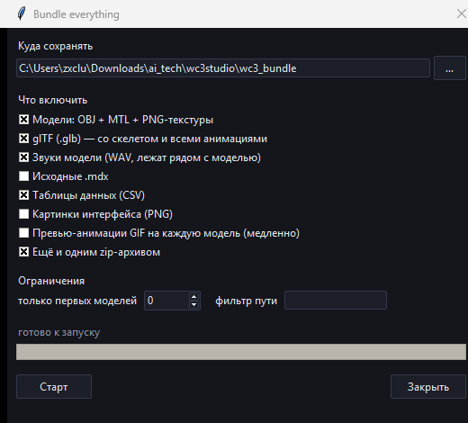

# wc3studio

[](https://github.com/zxclushkin/wc3studio/actions/workflows/ci.yml)
[](LICENSE)
[](pyproject.toml)
[](#установка)

Инструмент для работы с ассетами Warcraft III: читает архивы игры (MPQ), разбирает
модели (MDX), текстуры (BLP), **таблицы данных (SLK/TXT)** и **интерфейс (FDF)** —
и умеет всё это смотреть, анимировать, конвертировать и выгружать.

Есть **CLI** для скриптов и пакетной обработки и **GUI** для просмотра глазами.



**Содержание:** [Возможности](#возможности) · [Установка](#установка) ·
[Быстрый старт](#быстрый-старт) · [GUI](#gui) · [Таблицы данных](#таблицы-данных) ·
[Интерфейс](#интерфейс) · [Библиотека](#библиотека) ·
[Технические заметки](#технические-заметки) · [Тесты](#тесты) · [Ограничения](#ограничения)

## Возможности

| | |
|---|---|
| **Архивы** | `War3.mpq`, `War3x.mpq`, `War3xlocal.mpq`, `War3Patch.mpq` как цепочка патчей; поиск по 17 000 внутренних имён, регистронезависимый |
| **Модели** | разбор MDX: геосеты, материалы, текстуры, кости, иерархия, 11 типов анимационных треков |
| **Текстуры** | BLP1 в обоих вариантах — палитровый и JPEG (у него заголовок лежит отдельным блоком) → PNG |
| **Просмотр** | собственный программный рендер: z-buffer, UV, альфа-смешивание, скиннинг, контактная тень |
| **Анимация** | скелет, slerp-кватернионы, линейный скиннинг; плеер в GUI, экспорт GIF/MP4/PNG-секвенции |
| **Экспорт** | **OBJ + MTL + PNG-текстуры** и **glTF 2.0 (.glb)** со скелетом и всеми анимациями |
| **Данные** | 213 таблиц (SLK + INI) → CSV/JSON, склеенная база **812 юнитов** с русскими названиями и всеми характеристиками |
| **Интерфейс** | 86 FDF → дерево **2239 фреймов** с наследованием шаблонов, 1214 локализованных строк, выгрузка 1561 картинки UI в PNG |
| **Бандл** | `bundle` — всё сразу в папку и/или **zip**: OBJ, glTF с анимациями, **звуки модели**, `.mdx`, таблицы CSV, интерфейс PNG, GIF-превью, `models.json` и `manifest.json` |
| **Проверка** | `validate` (индексы OBJ, ссылки на MTL, структура GLB) и `doctor` (окружение, поиск игры) |

## Установка

Нужен Python 3.10+ (64-бит) и сама игра (или хотя бы её `.mpq`).

```powershell
cd wc3studio
pip install -e .
```

Зависимости: `pillow`, `numpy`; GUI — стандартный `tkinter`. Никаких сборок не нужно:
`vendor/StormLib.dll` (x64, MIT) уже в комплекте. Свою библиотеку можно подсунуть через
переменную `WC3STUDIO_STORMLIB`.

## Быстрый старт

```powershell
wc3studio doctor                                  # проверить окружение и найти игру
wc3studio archives                                # что лежит в архивах
wc3studio list --filter footman                   # поиск файлов
wc3studio info sheep                              # что внутри модели
wc3studio gui --model sheep --sequence Walk       # посмотреть глазами

wc3studio convert --model sheep --formats obj,glb --out out\sheep
wc3studio render  --model "Units\Human\Knight\Knight.mdx" --out knight.png --sequence Attack --time 0.5
wc3studio animate --model sheep --sequence "Stand,Walk,Walk,Death" --out out\sheep --mp4
wc3studio gallery --out out\gallery
wc3studio validate out\sheep

wc3studio tables                                  # какие есть таблицы данных
wc3studio units --limit 10                        # база юнитов с русскими названиями
wc3studio ui --frames --filter backdrop           # фреймы интерфейса
wc3studio ui-assets --out out\ui --sheet out\ui.png --filter Widgets

# всё сразу в папку и одним zip (главная команда, если нужен весь набор)
wc3studio bundle --out wc3_assets --formats models,glb,raw,tables --zip
```

Модель можно указывать полным внутренним путём, частичным или просто именем файла
(`sheep` → `Units\Critters\Sheep\Sheep.mdx`); при неоднозначности инструмент покажет
варианты.

### Пакетная обработка

```powershell
# все 3225 моделей игры в OBJ + GLB, с сохранением структуры каталогов
wc3studio convert --all --formats obj,glb --tree --out out\models

# только .mdx, как они лежат в игре
wc3studio extract --pattern "*.mdx" --out raw
```

## GUI

```powershell
wc3studio gui
```

* слева — дерево внутренних файлов с ленивой подгрузкой и поиском;
* в центре — превью: **мышью** вращение, **колесом** зум, стрелки — тоже вращение,
  `Space` — пуск/стоп анимации;
* справа — вкладки: параметры модели, список анимаций (двойной клик — проиграть),
  текстуры с превью, экспорт (OBJ / GLB / GIF / PNG / сырой `.mdx`),
  **Data** (все таблицы, двойной клик — таблица с фильтром и выгрузкой в CSV) и
  **UI** (FDF-документы, браузер фреймов, выгрузка картинок интерфейса).

Рендер идёт в отдельном потоке, поэтому интерфейс не замирает; устаревшие кадры
отбрасываются по идентификатору запроса. Таблицы и FDF тоже грузятся в фоне.

## Таблицы данных

Игра хранит все свои числа не в коде, а в текстовых таблицах: 59 файлов `.slk`
(SYLK-«эксель») и 154 `.txt` (INI-подобные). В них — юниты, способности, предметы,
постройки, звуки, апгрейды.

```powershell
wc3studio tables                                   # 213 таблиц с числом строк и колонок
wc3studio units --limit 10                         # склеенная база юнитов
wc3studio units --out units.csv                    # все 812 юнитов в CSV
wc3studio table UnitBalance --where level=1 --limit 5
wc3studio table UnitWeapons --columns unitWeapID,avgdmg1,DPS --format csv --out weapons.csv
```

`TableDatabase.units()` склеивает четыре таблицы (`UnitBalance`, `UnitData`,
`UnitWeapons`, `UnitAbilities`) по идентификатору юнита и подмешивает локализацию:

| id | name | race | level | hp | armor | damage | dps | gold | lumber | food |
|---|---|---|---|---|---|---|---|---|---|---|
| `hfoo` | Пехотинец | human | 2 | 420 | 2 | 12.5 | 9.26 | 135 | 0 | 2 |
| `ogru` | Бугай | orc | 3 | 700 | 1 | 19.5 | 12.19 | 200 | 0 | 3 |
| `ugho` | Вурдалак | undead | 2 | 330 | 0 | 13 | 10 | 120 | 0 | 2 |
| `earc` | Лучница | nightelf | 2 | 310 | 0 | 17 | 11.33 | 130 | 10 | 2 |
| `Hpal` | Паладин | human | 5 | 650 | 2 | 7 | 3.18 | 425 | 100 | 5 |

## Интерфейс

`.fdf` — текстовое описание интерфейса: дерево `Frame "TYPE" "NAME"` с свойствами,
вложенными `Texture { File "..." }`, наследованием шаблонов (`INHERITS`,
`INHERITS WITHCHILDREN`) и блоками `StringList` с локализованным текстом.

```powershell
wc3studio ui                                       # 86 документов, сколько в каждом фреймов
wc3studio ui --frames --filter backdrop            # список фреймов
wc3studio ui-frame StandardHeavyBackdropTemplate   # свойства с учётом наследования
wc3studio strings --kind ui --search меню          # подписи интерфейса
wc3studio ui-textures --filter Widgets             # картинки интерфейса
wc3studio ui-assets --out out\ui --filter Widgets --sheet out\ui.png
```



* 2239 фреймов, 1849 уникальных имён, **ноль предупреждений** парсера на всех 86 файлах;
* `ui-frame` показывает итоговые свойства с пометкой, из какого шаблона они пришли, и
  проверяет, есть ли текстуры в этой установке (208 ссылок разрешаются, 34 — из более
  новых патчей, их в архивах нет);
* 1214 локализованных строк (в этой установке — русских): `|Cffffff00Ловкость|R` и т.п.;
* выгрузка картинок интерфейса: 1561 изображение, 84 МиБ, плюс контактный лист.

## Скачать всё сразу

Одна команда собирает полный набор в папку и, если нужно, одним zip-архивом:

```powershell
# по умолчанию: модели + glTF с анимациями + звуки
wc3studio bundle --out wc3_assets --zip

# вообще всё: модели (OBJ+PNG), glTF, звуки, исходные .mdx, таблицы CSV, интерфейс
wc3studio bundle --out wc3_assets --formats all --zip

# плюс короткие GIF-превью анимаций (медленнее)
wc3studio bundle --out wc3_assets --formats all --previews --zip

# быстрая проба: 20 моделей
wc3studio bundle --out wc3_assets --limit 20 --filter "Units\Human" --zip
```

Что попадает в папку — всё, что относится к модели:

```
wc3_assets/
  Units/Human/Footman/Footman.obj + .mtl           модель
  Units/Human/Footman/Footman.glb                  glTF: скелет + все анимации
  Units/Human/Footman/Footman_Portrait.*           портрет (отдельная модель)
  Units/Human/Footman/FootmanYes1.wav … (18 шт)    звуки юнита
  textures/Textures/Footman.blp.png                текстуры
  raw/Units/Human/Footman/Footman.mdx              исходники
  tables/Units/UnitBalance.slk.csv                 таблицы данных
  ui/UI/Widgets/....png                            интерфейс (с форматом ui)
  models.json                                      индекс: что с какой модели
  manifest.json                                    что записано, сколько, ошибки
wc3_assets.zip                                     если указан --zip
```

**Анимации** для модели уже лежат внутри `.glb`: каждая последовательность MDX
(`Stand`, `Walk`, `Attack`, `Death`…) становится отдельной glTF-анимацией со всеми
костями. Дополнительно `--previews` рендерит по короткому GIF на модель (по умолчанию
из `Stand`), а `--sequences Stand,Walk` ограничивает набор анимаций в glTF.

**Звуки.** MDX на звук не ссылается — игра кладёт реплики юнита в его папку
(`Units\Human\Footman\FootmanYes1.wav`). Поэтому бандл забирает все `.wav`/`.mp3` из
папки модели и кладёт рядом с мешом: у Пехотинца их 18, у Паладина 22, у Овцы 7,
у Ратуши 3. Всего в архивах 444 таких папки и около 2900 файлов. WAV копируются как
есть — это оригиналы из MPQ, без пережатия.

**`models.json`** — индекс «всё с модели», по записи на модель:

```json
{
 "model": "Units\\Human\\Footman\\Footman.mdx",
 "folder": "Units/Human/Footman",
 "portrait": "Units\\Human\\Footman\\Footman_Portrait.mdx",
 "files": ["Footman.obj", "Footman.mtl", "Footman.glb"],
 "textures": ["Textures\\Footman.blp", "Textures\\gutz.blp"],
 "sounds": ["FootmanDeath.wav", "... 18 всего"],
 "sound_count": 18,
 "triangles": 372, "bones": 40, "geosets": 5,
 "animations": ["Stand - 1", "Stand - 2", "Stand Victory", "..."]
}
```

Сколько это весит и длится (замерено на этой машине): 71 модель Human-юнитов
с `models,glb,sounds,tables` — **93 МиБ за 35 секунд** (из них 45 МиБ — 478 звуков),
zip — 67 МиБ. Полный набор с звуками — примерно **2.2 ГиБ и 20 минут**, больше
половины — glTF (около 0.55 МиБ на модель, потому что внутри анимации).

В GUI то же самое: вкладка **Export** → **«Bundle everything…»** — галочки форматов
(включая звуки), лимит моделей, фильтр пути и прогресс-бар; работа идёт в отдельном
потоке.



## Библиотека

```python
from wc3studio import Game, Resources, parse_mdx, render, export_obj, export_glb

game = Game.autodetect()                       # или Game.open(r"C:\Games\Warcraft III")
resources = Resources(game)

data  = game.read(r"Units\Critters\Sheep\Sheep.mdx")
model = parse_mdx(data)

print(len(model.geosets), "geosets,", len(model.sequences), "animations")
render(model, resources, size=512).save("sheep.png")
export_obj(model, "sheep.obj", resources)
export_glb(model, "sheep.glb", resources)       # скелет + все анимации
```

Более высокоуровневый вход — `wc3studio.pipeline.Session`: он держит открытую игру,
кэши моделей и текстур и объединяет все операции (им пользуются CLI и GUI).

```python
from wc3studio import TableDatabase, UiLibrary

units = TableDatabase(game).units()               # 812 юнитов одной таблицей
units.write("units.csv", "csv")
print(units.find_row("hfoo"))                     # ['hfoo', 'Пехотинец', 'human', ...]

ui = UiLibrary(game)
details = ui.resolve("StandardHeavyBackdropTemplate")
print(details["chain"], details["textures"])     # шаблон + его текстуры
print(ui.strings()["AGILITY"])                    # 'Ловкость'
```

| Модуль | Что делает |
|---|---|
| `stormlib.py` | ctypes-обёртка StormLib, `Archive`, `Game` (цепочка патчей, регистронезависимый поиск) |
| `mdx.py` | парсер MDX: чанки, геосеты, материалы, узлы скелета, треки, последовательности |
| `blp.py` | декодер BLP1 (палитра и JPEG-вариант) |
| `tables.py` | SYLK/INI, `Table`, `TableDatabase`, склейка базы юнитов, CSV/JSON |
| `ui.py` | `parse_fdf`, дерево `Frame`, `UiLibrary` (шаблоны, строки, картинки, контактный лист) |
| `anim.py` | скелет, сэмплирование треков, slerp, линейный скиннинг |
| `render.py` | программный рендер (z-buffer, текстуры, blending, скиннинг, тень) |
| `objexport.py` | OBJ/MTL + PNG-текстуры |
| `gltf.py` | экспорт .glb (скин + анимации) и чтение .glb для проверки |
| `resources.py` | разрешение путей текстур и кэш изображений |
| `pipeline.py` | `Session`, рендер анимации, GIF/MP4 |
| `bundle.py` | `bundle`: модели, glTF, raw, таблицы и интерфейс в папку/zip + `manifest.json` |
| `cli.py`, `gui.py` | интерфейсы |

## Технические заметки

Интересное, что пришлось разобрать (подробности — в docstring'ах модулей):

* **MPQ.** Сборка StormLib — Unicode и ищет имена **с учётом регистра**, а модели
  ссылаются на текстуры в другом регистре. Все обращения идут через регистронезависимый
  индекс из listfile.
* **BLP1** бывает двух видов. Палитровый — палитра BGRA по смещению 156. JPEG-вариант
  хранит общий заголовок JPEG (SOI, APP0, DQT, DHT) отдельным блоком, обрывающимся ровно
  на маркере `FF C0`, а в mip-данных лежит остаток кадра. Полный JPEG = заголовок + mip.
* **Скрытые геосеты.** Кровь, сплат-плоскости и эффекты прячутся альфой геосета (`KGAO`),
  а у зданий теми же дорожками переключаются уровни апгрейда. Берётся поза на кадре
  старта первой анимации — так из Town Hall получается ратуша, а не три здания друг на друге.
* **Кватернионы.** Соседние ключи поворота часто записаны с разным знаком (`q` и `−q`).
  Обычная линейная интерполяция проходит через ноль и разрывает меш — нужен slerp с
  выбором короткой дуги.
* **glTF и пивоты.** Локальная матрица узла MDX — это
  `T(pivot)·T(t)·R·S·T(-pivot)`, что не является обычным TRS. При `A = R·S` она равна
  `[A | pivot + t − A·pivot]`, поэтому в glTF перенос узла считается как
  `pivot + t − A·pivot`, а inverse bind матрицы — единичные. Так как `A` меняется при
  вращении, канал переноса нужен **каждой** анимированной кости, даже если у неё нет
  своего трека переноса; интервалы между ключами дополнительно дробятся по углу поворота,
  чтобы линейная интерполяция glTF не расходилась с движком (расхождение < 0.1 единицы).
* **SLK.** Это SYLK, а не бинарь: одна запись `C;` на ячейку, а номер строки `Y`
  указывается **только при её смене** — если читать как обычные координаты, из 57 колонок
  получится одна. Плюс кавычки экранируются удвоением (`""`), а `#VALUE!` из исходных
  эксель-таблиц так и лежит в данных.
* **FDF.** Простой на вид формат, но с ловушками: `INHERITS WITHCHILDREN`, `Frame"TYPE"`
  без пробела, `String "X" INHERITS`, `Texture INHERITS` без имени, комментарии двух видов
  и — главное — `Text "KEY"` это **свойство**, а `Texture { ... }` — **блок**. Парсер
  решает по просмотру вперёд: блок только там, где дальше идёт `{`.

## Тесты

```powershell
python -m unittest discover -s tests -v
```

64 теста в четырёх наборах:

* **`tests/test_synthetic.py`** — модель MDX собирается прямо в памяти и проходит весь
  конвейер (парсинг → рендер → OBJ → GLB → чтение обратно). Работает без игры, поэтому
  крутится в CI. Среди проверок — что поворот кости идёт вокруг её пивота: кость с пивотом
  `(5,0,0)`, повёрнутая на 90° вокруг Z, обязана перевести вершину `(0,0,0)` в `(5,-5,0)`.
* **`tests/test_tables_ui.py`** — тоже без игры: синтетические SLK (с «ленивым» `Y` и
  экранированными кавычками), INI с секциями и разреженными ключами, FDF со всеми
  вариантами синтаксиса и вложенными блоками, CSV/JSON-экспорт, контактный лист.
* **`tests/test_bundle.py`** — zip-складывание папки (без игры) и сборка бандла на реальных
  архивах: сколько файлов получилось, куда, что в `manifest.json` и `models.json`, что
  `.glb` внутри бандла действительно содержит анимации, и что 18 звуков Пехотинца лежат
  рядом с его мешом. Тест на порядок «манифест → архив» поймал настоящую ошибку:
  манифест сначала писался после архивации и не попадал в zip.
* **`tests/test_wc3studio.py`** и игровые тесты в `test_tables_ui.py` — на реальных
  архивах: 812 юнитов, ноль предупреждений на 86 FDF, локализованные строки, инвентарь
  картинок. Без установленной игры помечаются как skipped.

Самый ценный — round-trip GLB: файл читается обратно, скиннинг из него сравнивается с
эталонным скиннингом MDX; расхождение должно быть меньше 0.5 единицы. Дополнительно
экспорт проверялся сторонним загрузчиком (`tools/verify_glb_trimesh.py`): вершины,
треугольники и границы совпадают с исходной моделью.

## Структура репозитория

```
wc3studio/            пакет
  stormlib.py         MPQ через StormLib (ctypes)
  mdx.py  blp.py      парсеры форматов ассетов
  tables.py           SLK/INI: таблицы данных, база юнитов
  ui.py               FDF: дерево фреймов, строки, картинки интерфейса
  anim.py             скелет и скиннинг
  render.py           программный рендер
  objexport.py        OBJ/MTL
  gltf.py             .glb (скин + анимации) и его чтение
  resources.py        текстуры и кэш
  pipeline.py         Session — общий слой для CLI и GUI
  bundle.py           bundle: полный набор в папку/zip + manifest
  cli.py  gui.py      интерфейсы
  vendor/             StormLib.dll (x64, MIT)
tests/                64 теста
tools/                smoke-скрипты, проверка GLB через trimesh, захват окна
docs/                 скриншот, галерея, демо-анимация, картинка интерфейса
.github/workflows/    CI
```

## Ограничения

* Партиклы, ленты, источники света и камеры не переносятся — в меш и glTF их не положить.
* Alpha-анимации геосетов (скрытие частей во времени) в glTF не экспортируются: формат
  этого не умеет без расширений. Статичный набор геосетов берётся по «стоячей» позе.
* Интерполяция типов 2 (hermite) и 3 (bezier) сэмплируется линейно: касательные лишь
  изгибают кривую между ключами, на глаз при покадровом рендере это не видно.
* Результат — ассеты Blizzard. Для личного использования и моддинга это обычная практика,
  распространять их как свои нельзя.

## Лицензии

Код — MIT. `vendor/StormLib.dll` — StormLib © Ladislav Zezula, MIT
(текст в `wc3studio/vendor/README.txt`). Ассеты Warcraft III принадлежат Blizzard
Entertainment и в поставку не входят.
